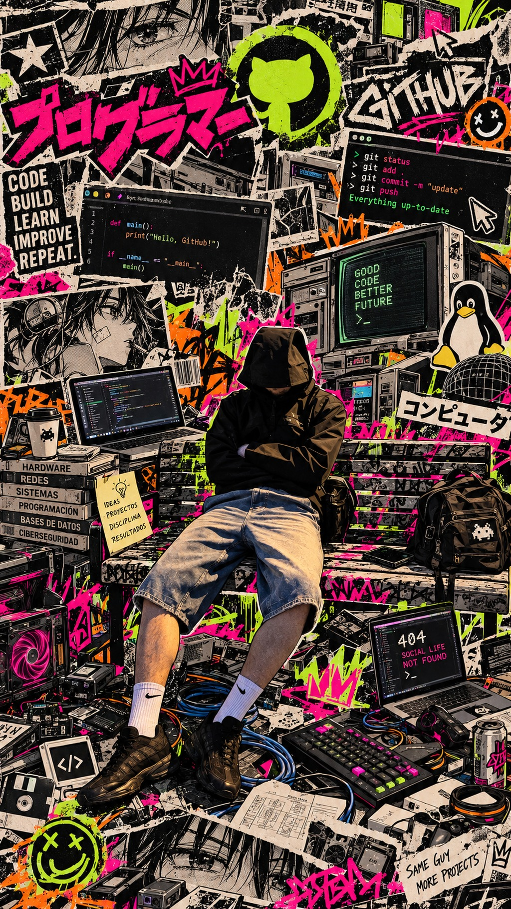

# portfolio-juan-montesdeoca

# Hola, soy Juan Montesdeoca Ferri 👋

Tengo 19 años y estudio el ciclo formativo de **Sistemas Microinformáticos y Redes (SMR)**.

Lo que más me gusta es el **montaje de ordenadores** y el **soporte técnico presencial**: diagnosticar el problema delante del equipo y dejarlo funcionando. También me interesan los **sistemas operativos** y las **redes**, que sigo aprendiendo.

## Objetivo profesional

Quiero trabajar como **técnico de soporte informático presencial**, montando, reparando y manteniendo equipos, y atendiendo en persona a usuarios y empresas. A medio plazo me gustaría ampliar mis conocimientos de redes y sistemas.
